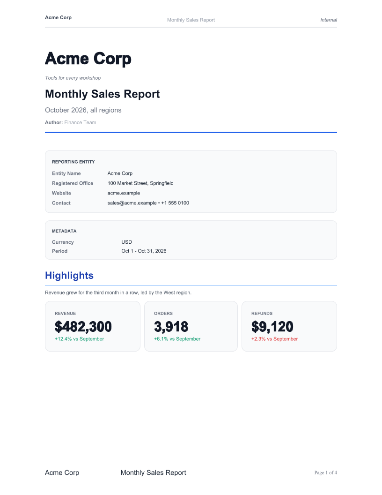
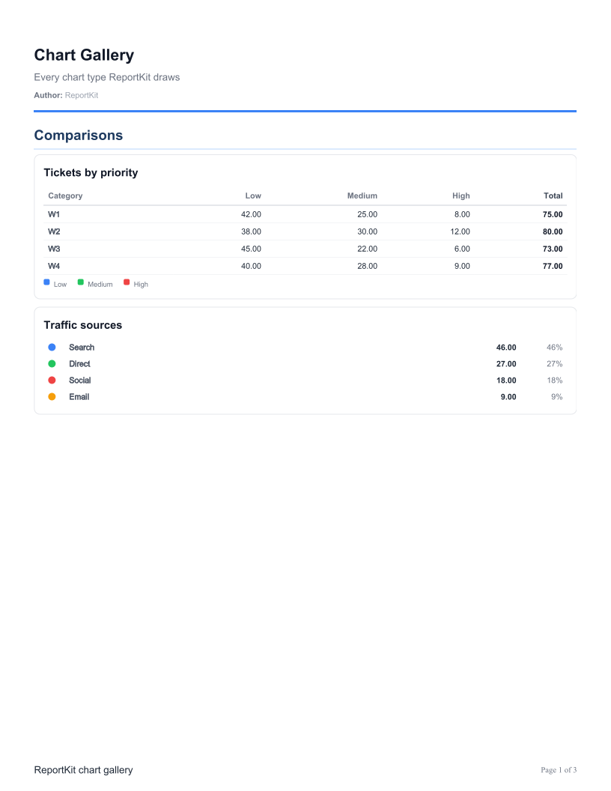
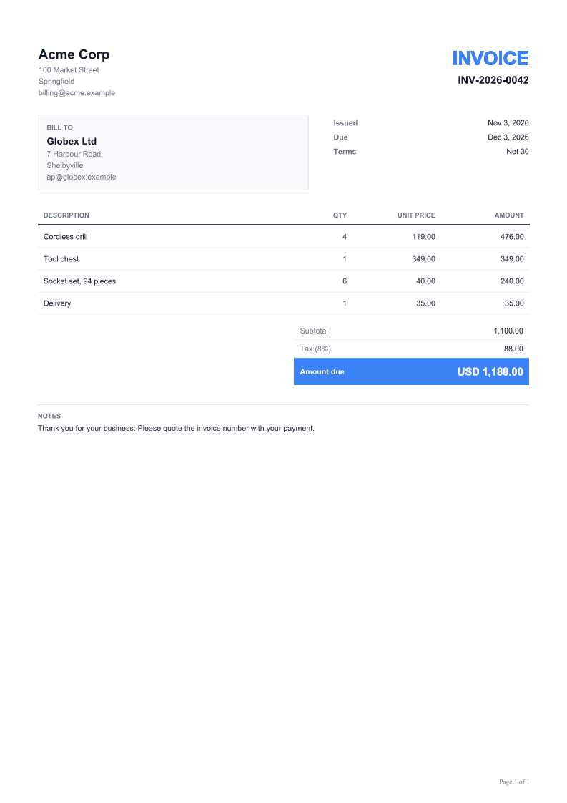

# ReportKit

Build reports, dashboards and invoices in plain Java (KPI cards, charts and tables) and export them as
HTML or PDF. No browser, no server, no annotations: a fluent builder, FreeMarker templates and
[Flying Saucer](https://github.com/flyingsaucerproject/flyingsaucer) for the PDF.

| Sales report | Chart gallery | Invoice |
|---|---|---|
|  |  |  |

## Install

Java 25 or newer.

```xml
<dependency>
    <groupId>io.joshuasalcedo</groupId>
    <artifactId>reportkit</artifactId>
    <version>1.0.0</version>
</dependency>
```

ReportKit logs through SLF4J and ships no logger of its own; your application's logger is used.

## A report

```java
import static io.joshuasalcedo.reportkit.DataKitAPI.*;

import io.joshuasalcedo.reportkit.ReportAPI;
import io.joshuasalcedo.reportkit.ReportExporter;
import io.joshuasalcedo.reportkit.ReportStyle;

var report = ReportAPI.report("Monthly Sales Report")
    .author("Finance Team")
    .company(c -> c.name("Acme Corp").tagline("Tools for every workshop"))
    .footer(f -> f.left("Acme Corp").center("Monthly Sales Report").pageNumbers(true))
    .section("Highlights", s -> s
        .narrative("Revenue grew for the third month in a row.")
        .add(
            kpiCard("Revenue", "$482,300", "+12.4% vs September", true),
            kpiCard("Orders", "3,918", "+6.1% vs September", true),
            kpiCard("Refunds", "$9,120", "+2.3% vs September", false)))
    .section("Revenue by region", s -> s
        .add(barChart("Revenue by region", "Region", "USD", List.of(
            category("West", 168_400),
            category("East", 131_900),
            category("North", 102_700)))))
    .build();

var exporter = ReportExporter.createDefault();
Files.write(Path.of("sales.pdf"), exporter.reportToPDF(report, ReportStyle.MODERN).bytes());
Files.writeString(Path.of("sales.html"), exporter.toHTML(report).html());
```

`ReportExporterAPI` does the same in one chain and ends with `.export(Path.of("sales"))`, which writes
`sales.html` and `sales.pdf`.

## An invoice

```java
var invoice = new InvoiceDocument(
    "Invoice", "INV-2026-0042",
    new Party("Acme Corp", List.of("100 Market Street", "Springfield")),
    new Party("Globex Ltd", List.of("7 Harbour Road", "Shelbyville")),
    List.of(new Detail("Issued", "Nov 3, 2026"), new Detail("Due", "Dec 3, 2026")),
    List.of(new Line("Cordless drill", "4", "119.00", "476.00")),
    List.of(new Detail("Amount due", "USD 476.00", true)),
    "",          // a stamp such as "PAID", or empty
    "Thank you for your business.");

byte[] pdf = ReportExporter.createDefault().invoiceToPDF(invoice).bytes();
```

Every value is already formatted text, so you decide how amounts and dates read.

## What's in the box

- **Visualizations:** KPI cards, data tables (with a total row), bar, stacked bar, line, area, pie,
  donut, scatter, bubble, radar, funnel, gauge, time series and heat map.
- **Document styling:** company profile and cover, running header and footer, page numbers, page size
  (Letter, A4, A3, Legal, Tabloid), orientation and margins.
- **Styles:** `ReportStyle.DEFAULT`, `COMPACT`, `MODERN`, `CORPORATE` and `MINIMAL`, or your own via
  `ReportStyle.builder()`.
- **Safe text:** every value is escaped, so names with `&` or `<` can't break the document.

## Examples

The screenshots above come from the examples in
[`src/test/java/io/joshuasalcedo/reportkit/examples`](src/test/java/io/joshuasalcedo/reportkit/examples):

| Example | Shows |
|---|---|
| `SalesReportExample` | Company cover, KPI cards, bar, donut and line charts, a table with totals |
| `ChartGalleryExample` | Stacked bars, pie, radar, funnel, gauge and heat map |
| `InvoiceExample` | An invoice with lines, totals and a note |

To regenerate them:

```sh
mvn test-compile exec:java@screenshots
```

That writes each example's HTML and PDF to `target/examples` and every PDF page as a PNG to
`docs/screenshots`.

## Build

```sh
mvn verify
```

## Release

Releases go to Maven Central. Set the version in `pom.xml`, then:

```sh
mvn -Prelease deploy
```

This needs a Central Portal token as the `central` server in `~/.m2/settings.xml` and a GPG key to
sign with.

## License

[Apache License 2.0](LICENSE)
